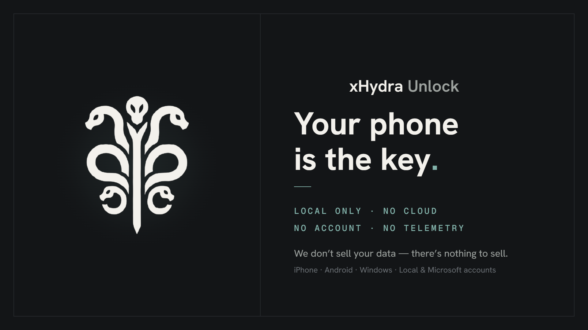

# xHydra Unlock Releases

This is the official public binary-release repository for **xHydra Unlock**. It is the
authoritative location for published Windows installers, release notes, SHA-256
checksums, public feedback, and security-reporting guidance.

The xHydra Unlock product source code is currently private. This repository intentionally
contains release information and distribution artifacts only; it does not contain the
private product source.

## Current release

**Windows companion: xHydra Unlock 1.3.0**

- [Download xHydra Unlock 1.3.0 for Windows](https://github.com/TahaHydra/XHydra-unlock-release/releases/download/v1.3.0/xHydraUnlock-1.3.0.msi)
- [Read the 1.3.0 release notes](https://github.com/TahaHydra/XHydra-unlock-release/releases/tag/v1.3.0)
- [Download the SHA-256 checksum](https://github.com/TahaHydra/XHydra-unlock-release/releases/download/v1.3.0/xHydraUnlock-1.3.0.sha256.txt)

Published SHA-256:

```text
B465DD4C8F5F3C6E35B27555E1CF381B8B358D6D319F3AA6819A23E4951C5610  xHydraUnlock-1.3.0.msi
```

Verify a downloaded copy in PowerShell:

```powershell
Get-FileHash .\xHydraUnlock-1.3.0.msi -Algorithm SHA256
Get-AuthenticodeSignature .\xHydraUnlock-1.3.0.msi
```

The MSI is the complete Windows installer and is distributed directly rather than
wrapped in an additional ZIP archive.

> **Signed installer:** starting with 1.2.0, the MSI and the programs it installs are
> Authenticode-signed by **Taha Laachari** (certificate issued by Certum). The signature
> status must be **Valid**. Because the certificate is new, Windows SmartScreen may still
> show a warning until it has built reputation. Download xHydra Unlock only from the
> official xHydra website or this GitHub release.

Installed 1.1.x and 1.2.x copies offer this update from **Settings › Software update**.

## About xHydra Unlock

xHydra Unlock is a Windows 10/11 companion system that lets a paired iPhone or Android
phone approve a Windows unlock and perform authorized PC actions.

Version 1.1.0 introduced:

- PC controls for **Lock, Sleep, Restart, and Shut down**;
- **Wake-on-LAN** support;
- a redesigned Windows companion;
- improved pairing and paired-PC management;
- OS device-authentication fallback when biometrics are unavailable;
- opt-in access over a private VPN; and
- reliability and security hardening across the Windows and mobile components.

Windows 1.3.0 adds the **Activity** page: every unlock, PC control and pairing attempt
from your phones, and when one was refused, the reason in plain words with a link to the
setting that fixes it. Phones are still told only that a request wasn't accepted. Windows
sign-in setup now names the exact password your account needs (Microsoft account, work or
school, domain or Windows) and catches a Windows Hello PIN before it is checked.

Windows 1.2.1 signs every program file in the installer, as the Microsoft Store
requires, and shows the publisher as **xHydra**.

Windows 1.2.0 signs the installer and the Windows programs, replaces the separate VPN
permissions with one **Allow access over private VPN** setting (existing settings carry
over), shows network warnings on Home, makes Sleep work on Modern Standby PCs, and
starts the app right after installation without a forced restart. See the [changelog](CHANGELOG.md) for details.

Windows 1.1.1 fixed pairing persistence consistency so a failed persistence write no
longer changes the live trusted-device state, and makes pairing QR nonce consumption
atomic to prevent concurrent reuse. The pairing UI now includes
“Don't have the mobile app? Get xHydra Unlock”, linking to the
[product page](https://xhydra.fr/products/xhydra-unlock). This Windows release does not
include Android or iOS changes.

The Windows companion is public here. The Android and iPhone apps are distributed through
their respective mobile testing/store channels rather than as binaries in this repository.

## Security model

xHydra Unlock is designed to stay local-first:

- no xHydra cloud account is required for the core unlock flow;
- no cloud unlock relay is used;
- no xHydra telemetry is required for the core product;
- LAN operation is the default;
- private VPN access is explicitly opt-in;
- Public Windows network profiles remain blocked;
- every privileged phone action requires OS-level device authentication;
- mobile signing keys are hardware-backed where the platform supports it;
- the paired PC is authenticated with pinned TLS identity;
- unlock/control requests use fresh challenges with replay protection; and
- the Windows credential remains encrypted locally on the PC and is never stored on the
  phone.

For vulnerability reporting and release-integrity guidance, see
[SECURITY.md](SECURITY.md).

## Official links

- Website: [xhydra.fr](https://xhydra.fr)
- Product page: [xHydra Unlock](https://xhydra.fr/products/xhydra-unlock)
- Releases: [GitHub Releases](https://github.com/TahaHydra/XHydra-unlock-release/releases)
- Feedback: [Report a bug or suggest a feature](https://github.com/TahaHydra/XHydra-unlock-release/issues/new/choose)

## Feedback

Use the public issue forms for normal bugs and feature requests. Include the affected
version, reproduction steps, and expected versus actual behavior.

Never attach passwords, pairing QR codes, private keys, purchase tokens, credential
blobs, or unredacted logs.

For a security vulnerability, **do not open a public issue**. Follow
[SECURITY.md](SECURITY.md).

## Previous releases

Older releases remain available from the
[GitHub Releases page](https://github.com/TahaHydra/XHydra-unlock-release/releases).

The previous Windows release was
[xHydra Unlock 1.2.1](https://github.com/TahaHydra/XHydra-unlock-release/releases/tag/v1.2.1). Its published MSI has SHA-256:

```text
134542FCEE12E16DD9EA6177A27CD0DA69C6DB6668BF3E591BFAA3AA97213132  xHydraUnlock-1.2.1.msi
```

The last unsigned release was
[xHydra Unlock 1.1.1](https://github.com/TahaHydra/XHydra-unlock-release/releases/tag/v1.1.1), SHA-256:

```text
9F21EF037BCB6FEE7B4532F71B8A130F297BDAED5CCDF8661808A810E7FAA953  xHydraUnlock-1.1.1.msi
```

## Release artifact policy

Public binaries are attached to GitHub Releases rather than committed into this
repository's git history. See [`releases/README.md`](releases/README.md) for the
artifact policy and verification guidance.
